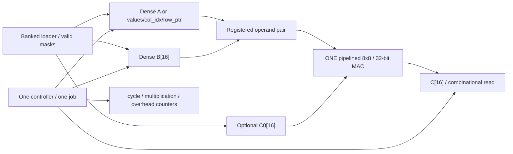
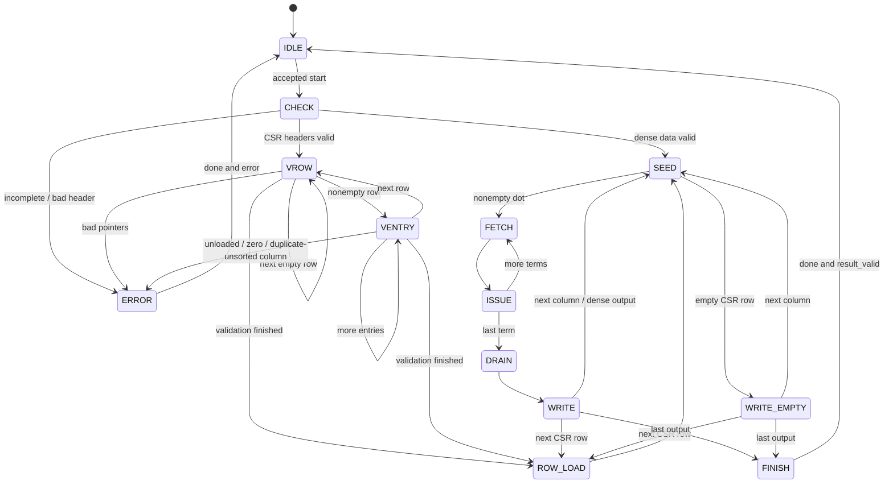

# Gate 4 contract: 4x4 Dense / CSR-A matrix engines

Status: Gate 4A specification, 2026-11-03. The current user request supersedes
the kickoff RQ2 choice of sparse B: **A is CSR, B is dense**. Gate 1–3 files
remain unchanged; Gate 3 snapshot is `50087fe352567a0a5b8a15814d4f532f804a25d4`.

## Arithmetic and resource budget

`C[i,j] = sum(k=0..3, A[i,k]*B[k,j]) mod 2^32`, signed INT8 inputs, exact signed
16-bit products, signed 32-bit results. Each engine instantiates exactly one
shared `matrix_mac` (one multiply expression, one accumulator). No parallel
multiply units, no gated clocks, no skipping dense zero products.

Default `seed_enable=0` loads zero before each dot product. Optional latched
`seed_enable=1` loads C0[i,j], giving `C=C0+A*B mod 2^32`. This symmetric extension
allows legal matrix-level overflow tests: four INT8 products from zero are
bounded by [-65024,65536], so pure 4x4 GEMM cannot overflow INT32. No hierarchical
force/deposit is used to manufacture overflow coverage.

The new MAC preserves the Gate 1 E[n] -> E[n+1] interval between valid input and
updated accumulator/output valid. `load_acc` synchronously loads a 32-bit seed
and flushes pending work. Gate 1 MACs and their contract are not modified.

## Common top-level interface

Modules: `matrix_dense` and `matrix_csr`, fixed 4x4 sizes.

| Port | Meaning |
| --- | --- |
| clk, rst_n | One clock, synchronous active-low reset |
| start | Accepted on a rising edge in IDLE with reset deasserted |
| seed_enable | Latched with accepted start; otherwise ignored during busy |
| busy | High in all non-IDLE states, including validation and finish/error |
| done | One-cycle pulse on success or rejected malformed/incomplete job |
| error | Sticky job error until next accepted start/reset |
| result_valid | High only after successful completion; holds until next start/reset |
| load_valid, load_ready | One write accepted when both high on rising edge |
| load_bank[2:0], load_addr[4:0], load_data[31:0] | Banked configuration port |
| read_addr[3:0], read_data[31:0] | Combinational row-major C read, zero unless result_valid |
| cycle_count[31:0] | Rising-edge intervals from accepted start to done (start edge excluded, done edge included) |
| mac_count[15:0] | Number of accepted valid multiplication transactions in the current job |
| control_cycles[31:0] | cycle_count - mac_count; all non-issue cycles, not a separate datapath timing estimate |

Priority: reset > accepted start (IDLE) > idle load; busy start/write requests
are ignored (no queue, no corruption). `load_ready = rst_n && IDLE && !start`.
Use a start pulse; a level held until a later IDLE can be accepted as a new job.
Reset aborts, clears status/counters and all loaded-valid flags, flushes the MAC,
and requires data reload. Data RAM bits need not reset; invalid data/results are
never exposed. Missing required data terminates with done/error, result_valid=0.
No combinational clock gating. No overlapping jobs or loads during execution.

## Storage / loader / CSR canonical form

| Bank | Index | Payload |
| --- | --- | --- |
| 0 | 0..15 | Dense A row-major / CSR values; low signed 8 bits |
| 1 | 0..15 | Dense B row-major; low signed 8 bits |
| 2 | 0..15 | Optional C0 row-major, all 32 bits |
| 3 | 0..15 | CSR col_idx, low 2 bits (host must supply 0..3) |
| 4 | 0..4 | CSR row_ptr, low 5 bits (host must supply 0..16) |
| 5 | index 0 | CSR nnz, low 5 bits (0..16) |

Other addresses/banks are ignored. Upper bits outside the documented field are
not part of storage and must be zero/sign extension as applicable; malformed
tests use representable bad row pointers/nnz. Dense ignores banks 3–5.

CSR capacity: values[16] (INT8), col_idx[16] (2 bits), row_ptr[5] (5 bits), nnz
(5 bits). row_ptr[0]=0; row_ptr[4]=nnz; pointers monotonic and <=nnz. Entries in
each row have strictly increasing columns, no duplicates, no explicit zero
values. Empty rows have equal adjacent pointers. All-zero A has nnz=0 and all
five pointers zero. Unused entries need not load. CSR structure and loaded flags
are validated in hardware before issue; invalid input completes with error and
zero MAC count. B may contain zeros; valid multiplications for nonzero A with
zero B still issue and retire.

Logical byte-per-field host serialization (not packed bitstream): dense A=16
bytes; CSR A=2*nnz+6 bytes (values+one-byte columns+five pointer bytes+nnz byte).
B=16 bytes, optional seeds=64 bytes. Actual loader uses **32-bit writes** with
bank/address control: Dense=32 writes, CSR=22+2*nnz writes, plus 16 seed writes
when enabled. CSR compression is offline Python, not an on-FPGA operation.
Fixed-capacity on-chip metadata does not shrink with nnz.

## Datapath / FSM / timing

Dense schedules i,j,k dot products. CSR schedules each output dot product over
entries p in A's row, reading B[col_idx[p],j]. This reuses one accumulator
without C read-modify-write hazards. Each multiply has one FETCH cycle followed
by one ISSUE cycle. After final ISSUE, DRAIN retires the pending product; WRITE
samples the updated accumulator on the following edge. No writeback on the
same edge as the last product retirement.

State functions: CHECK checks required loaded masks/header; VROW checks pointer
bounds; VENTRY checks one canonical nonzero entry/cycle; ROW_LOAD caches row
bounds; SEED flushes/loads MAC; FETCH registers operands; ISSUE accepts one
multiply; DRAIN waits for L=1 retirement; WRITE stores a nonempty dot result;
WRITE_EMPTY stores the loaded seed without issuing any multiplication; FINISH
publishes all outputs atomically via result_valid; ERROR invalidates the result.

Predicted cycle accounting to verify against **actual simulation counters**:
Dense=178 cycles, 64 MACs. CSR=42+9*nnz+4*nonempty_rows cycles, 4*nnz MACs. These
formulas are expectations until executed; speedup uses measured cycle_count,
not the operation ratio. Configuration load counts and offline encoding time
are disclosed separately. Report kernel-only and load+kernel cycle comparisons;
the latter still excludes host preprocessing/transport beyond this local bus.

## Sequential acceptance

- 4A: locked contract + independent golden model/CSR encoder tests.
- 4B: Dense-only actual ModelSim check of all 16 outputs and protocol/reset.
- 4C: CSR-A actual ModelSim checks vs Dense and golden, malformed/empty rows.
- 4D: full regression, cycle/load/control CSV and equal-settings Quartus reports.

Quartus follows Gate 3's documented reference target, 10 ns budget, Standard
effort, seed 1, virtual I/O, normal DSP/logic optimization. No board pins. Check
actual mapped DSP/multiplier budget. Preliminary timing/device models remain a
limitation. Gate 4 power/board results are Pending unless actually executed.
