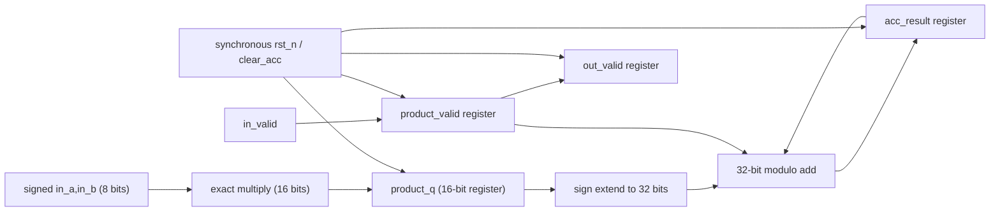
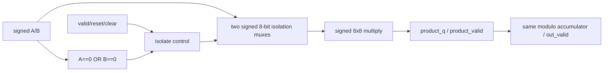

# Engineering Requirements / RTL Contract

## Locked baseline contract (Gate 0, 2026-11-03)

The following resolves the choices in RQ1; Gate 2 must preserve this contract.

| Item | Definition |
| --- | --- |
| Module | `mac_baseline`, fixed 8/16/32-bit widths |
| Inputs | `clk`, `rst_n`, `clear_acc`, `in_valid`, signed `[7:0] in_a,in_b` |
| Outputs | `out_valid`, signed `[31:0] acc_result`; no ready port |
| Acceptance | Rising edge with `rst_n=1 && clear_acc=0 && in_valid=1` |
| Reset | Active-low **synchronous**; sampled only on rising edges. Must assert for at least one rising edge before use. No defined power-up state before reset. |
| Priority | `!rst_n` > `clear_acc` > normal retirement/capture |
| Reset / clear | Both set accumulator, product register and all validity bits to zero; reject current input and cancel the one pending transaction. `clear_acc` applies even when `in_valid=0`. |
| Latency | L=1 rising-edge interval: accepted at E[n], corresponding updated accumulator and `out_valid=1` after E[n+1], unless reset/clear intervenes. TB samples after NBA updates. |
| Pipeline | E[n] registers exact signed 16-bit product; E[n+1] sign-extends it to 32 bits and accumulates. One input/cycle, one output/cycle after filling. |
| Arithmetic | `acc_next = (acc + a*b) mod 2^32`; output bits interpreted as signed two's complement. No saturation, overflow flag or exception. |
| Idle | No new input when `in_valid=0`; previously accepted product still retires. When no product retires, accumulator holds and `out_valid=0`. |
| Zero | A valid zero product retires with `out_valid=1` and unchanged accumulator; it is never discarded. |
| Flush accounting | Accepted = retired + explicitly cancelled + currently pending. Reset/clear cancellation is intentional, not normal transaction loss. |
| Output use | `acc_result` is always the current accumulator, holds on idle and is zero after reset/clear; consumers identify retirement with `out_valid`. Consecutive outputs may keep valid high for multiple cycles. |
| Throughput / clock | One synchronous domain, no backpressure, no generated/gated clock. TB's 10 ns period is stimulus only, not demonstrated Fmax. |

Example (values describe state **after** each rising edge):

| Edge | Input | out_valid | acc_result |
| --- | --- | --- | --- |
| E0 | reset asserted | 0 | 0 |
| E1 | valid, 3 * 5 | 0 | 0 |
| E2 | valid, 0 * -7 | 1 | 15 |
| E3 | idle | 1 | 15 |
| E4 | valid, -2 * 4 | 0 | 15 |
| E5 | clear and valid | 0 | 0 (pending -8 cancelled; coincident input rejected) |
| E6 | idle | 0 | 0 |

Boundary arithmetic examples: `-128 * -128 = 16384`; `-128 * 127 = -16256`;
`0x7fffffff + 1 -> 0x80000000`; `0x80000000 - 1 -> 0x7fffffff`.
The latter two illustrate the arithmetic rule; RTL tests reach wrap using only legal streamed operands, without depositing internal state.

Verification boundary: Python model -> deterministic cycle vectors -> self-checking SV TB -> baseline RTL. Every sampled cycle compares both output validity and all 32 result bits, including idle and flush cycles.

## Gate 2 sparse implementation (2026-11-03)

The user-requested filename/module is **`rtl/mac_sparse.sv` / `mac_sparse`**, replacing the kickoff's suggested `mac_sparse_aware.sv` name. Public ports, widths, arithmetic, acceptance, L=1, throughput, reset, clear and flush semantics remain exactly the locked baseline contract above. Baseline RTL, golden model, Gate 1 generator, TB and evidence remain unchanged in commit `faaf5f63a4563a289e809fb3699eb3e01357b2dc`.

- `a_is_zero=(in_a==0)`, `b_is_zero=(in_b==0)`, `zero_detect=a_is_zero|b_is_zero`.
- `isolate_active = !in_valid | zero_detect | !rst_n | clear_acc`.
- Both **signed 8-bit** multiplier operands are muxed to signed zero during isolation, otherwise passed through. The signed 16-bit product is registered on every valid accepted transaction, including zeros.
- No new sequential state or clock enable is introduced. Existing product/accumulator update conditions match baseline. In particular, product_q is set to zero for valid zero inputs rather than incorrectly holding a preceding nonzero product.
- Valid propagation is independent of zero detection. All clocks remain the same ungated clock.
- Reset/clear may change combinational operand nets immediately; architectural registers only reset/clear on the rising edge, preserving synchronous semantics.

### Gate 2 activity measurement contract

The workload measures 4000 **valid** transactions, with exact zero-product rates 0/25/50/75/90%, for random-position and bursty-position masks, using seeds 0x1234/0x4567/0x89AB (30 VCD cases). Bursty masks have 20 periods of 200 cycles: the first `2*rate` cycles of each period are zeros. Random masks are fixed-count shuffles. Zero cases cycle among A=0, B=0 and both=0, with changing partner operands.

For a seed, each workload repeats the same 100-pair nonzero pool; all nonzero counts are multiples of 100. Thus the **empirical distribution of nonzero pairs** is identical across rates/patterns, verified by a normalized distribution SHA256. Zero-case sequences also have identical order at a given rate; placement differs. Input timing is fixed: every measured cycle valid, no reset/clear. Low-valid-rate energy is outside this workload study, although noisy invalid traffic is functionally verified and isolated by RTL.

Warm-up: 2 reset + 4 idle + 16 valid + clear + idle = 24 rows. Measurement gate is high from the falling edge driving row 25 to the falling edge driving row 4025: **[250 ns, 40250 ns)**, 40000 ns, with a 10 ns stimulus clock. Input transitions at the first boundary are included; drain input transitions at the closing boundary are excluded. Both DUTs share that interval and predecessor state. The final transaction retires during drain, outside the activity window; correctness checking includes drain.

For each VCD signal, bit toggles are the sum of Hamming distances between consecutive emitted known values whose event timestamp lies in that half-open interval. The prior value before the interval supplies the initial comparison. Unknown/uninitialized values at the boundary or inside the window cause failure, not silent omission. Scalar, vector, alias and ModelSim bit-blasted bus declarations are supported. Count only emitted VCD changes; this is not a complete physical glitch model.

| Metric | Observation scope per DUT | Width / definition |
| --- | --- | --- |
| Multiplier operand toggles | baseline raw in_a/in_b; sparse post-isolation mul_a/mul_b | Sum of two 8-bit net toggles (16 bits) |
| Product datapath | combinational product | 16 bits, separate from product register |
| Product register transitions | product_q | 16 register output bits |
| Accumulator transitions | acc_result | 32 register output bits |
| Register data transitions | product_q + acc_result + product_valid + out_valid | 50 bits, register output changes, not clock loads/D-input glitches |
| Zero detector cost | a_is_zero + b_is_zero + zero_detect | Sum of 3 one-bit sparse control net toggles; no baseline counterpart |
| Isolation control | isolate_active | 1 bit, reported separately from detector |
| Clock / update conditions | clk, capture_condition, each acc_condition | Common clock transitions; pre-edge high-condition counts. These are TB aliases of existing update conditions; no new CE was implemented. |

These scopes overlap (e.g. product register is also in register subtotal); do not add all metric columns into a whole-design total. Reduction for a matched metric is `100*(1-sparse/baseline)` when baseline is nonzero. Control event counts are not weighted by capacitance and cannot be subtracted as power. FPGA/ASIC power and mapped hardware cost remain Pending until actual appropriate tool runs.

## RQ1: Baseline MAC vs sparse-aware MAC (required MVP)
- Language: synthesizable SystemVerilog (Quartus-compatible subset), self-checking SystemVerilog TB.
- Single synchronous clock domain, active-low reset (synchronous or asynchronous choose and lock in spec), no combinational clock gating.
- Signed 8-bit `a`, `b`; signed 16-bit exact product; signed 32-bit accumulator; 32-bit **two's complement modulo wraparound** on overflow. Never silently saturate.
- Define input `in_valid`, `in_a`, `in_b`, `clear_acc`; output `out_valid`, `acc_result`; optional `in_ready` fixed high if always accepts 1/cycle. Explicitly document latency L in cycles from accepted input to valid output, and verify both variants have the same L.
- Transaction semantics: every accepted `in_valid` input advances the accumulator by `a*b`, including a or b equal to zero (increment of zero), with `out_valid` at the same fixed latency in both variants. `clear_acc` priority, reset behavior and pipeline flush must be specified. No lost/duplicated transaction.
- `mac_baseline.sv`: straightforward multiplier data path and accumulator, no special explicit zero isolation.
- `mac_sparse.sv` (user-requested Gate 2 name): combinational zero detector feeding operand-isolation muxes; preserve timing and arithmetic. Zero case may set multiplier operand(s) to zero; clock enable only on registers with rigorously proved safe hold conditions. Do NOT gate accumulator valid transaction based solely on zero.
- Do NOT assume the synthesis tool will preserve 'intentionally inefficient' baseline. Inspect mapped logic to see whether the tool naturally converged both variants. Treat equality as a legitimate result.
- Use parametrizable widths if convenient, but ensure test covers the default 8/32 contract.

## RQ2: Matrix engine (stretch, only after RQ1 passes)
- First implement 4x4 dense GEMM reference and a 4x4 sparse GEMM variant: C = A * B, signed 8-bit input, 32-bit accumulating outputs, mod 2^32 when relevant. Design deterministic control and explicit result-valid/busy/done interface.
- Constrain comparable hardware: **one MAC functional unit per design** initially, same clock and output storage assumptions. Baseline dense: i,j,k nested traversal, N^3 multiply steps (for N=4, 64). This count is arithmetic steps, NOT automatically the total clock cycles.
- Sparse variant: initially B is sparse, encoded in CSR `(row_ptr[0..N], col_idx[0..nnz-1], value[0..nnz-1])`. For each nonzero B[k,j], accumulate A[i,k]*B[k,j] into C[i,j]. Count N*nnz nonzero multiply steps, plus decoder/control and memory accesses. Never equate this operation count to actual completed cycles without measuring the FSM.
- Disclose whether CSR compression is prepared offline by a Python stimulus loader; never include it in baseline cycles but exclude it from sparse cycles while claiming end-to-end acceleration. Show separate kernel-only and end-to-end results as appropriate.
- Edge cases: all-zero B, fully dense B, irregular sparse B, signed extremals, duplicate coordinate handling (if supported), load/reset and back-to-back command handling.
- Structured sparsity 2:4 and >4x4 scaling can be optional beyond the initial CSR prototype; don't claim parity with NVIDIA's hardware.

## Hardware board
- Primary tentative board: Terasic SoCKit / Cyclone V SoC. Confirm board rev and exact FPGA part before assigning pins.
- Display at least 3 run modes via switches/buttons and status through LEDs, based on **real hardware counters/results** where feasible. Start with switches + LEDs. The PC can show CSV plots collected from simulation for reproducible numeric comparisons.
- If power estimate requires vendor-specific timing/power data, use board-appropriate Quartus edition/device and annotate model/report details.
